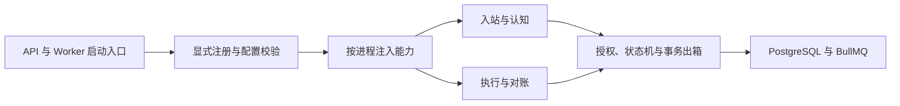

# Rica 插件架构重构计划

开发新插件时参阅[插件开发手册](plugin-development/README.md)。

依据[系统设计规范第 17 章](多平台多身份%20AI%20虚拟角色认知与自主行为系统设计规范.md#sec-17)，并沿用第 09 章的平台契约、第 10 章的审批执行规则和第 13 章的事务出箱。本文补充实施顺序与验收，现有 M1–M4 的行为以[开发路线图](roadmap.md)为回归基线。

## 1. 重构起点

| 当前实现 | 需要收敛的边界 |
| --- | --- |
| `registerPlugins` 已校验重复 ID、契约版本和未知实现。`mock-a`、`mock-b` 和 `simulated` 已有稳定 ID 和版本。 | 在进程入口统一装配显式允许列表、配置校验、宿主依赖与就绪状态。 |
| Worker 已能接收模型实现，模拟入站已支持启用列表。草稿、审批复核和执行路径仍有直接解析内置适配器的调用。 | 由启动入口注入能力解析器，领域流程使用同一部署选择，审批与执行复核同一版本。 |
| 入站记录适配器 ID 和版本，草稿记录模型 ID 和版本，模拟提案已有适配器版本和审批摘要。 | 补齐审批与许可所需的执行适配器 ID、实现版本和能力契约版本，保留旧记录语义。 |
| 本机试点已有独立的只读事件接收、单次发送及结果恢复。 | 先把只读协议接入平台能力，随后单独装配写入与对账，保留已有账本和进程权限。 |
| 已有授权候选排序和长期评测。 | 排序保留原算法，评测保留原输入和指标。出现第二种实现时，再抽取对应扩展点。 |

当前代码入口见[注册表](../packages/plugin-host/plugin-registry.ts)、[模型契约](../packages/contracts/runtime/model-provider.ts)、[模拟适配器](../packages/simulation/adapters/platforms.ts)、[模拟审批](../packages/simulation/workflow/review.ts)和[模拟执行](../packages/simulation/workflow/execution.ts)。

## 2. 目标架构

插件采用随 Rica 一起部署的 TypeScript 实现。pnpm workspace 共用根锁文件。各插件通过 `package.json` 声明入口和依赖，宿主以 `workspace:*` 引用。Hono API 和各 Worker 在各自入口使用工厂显式注册，部署配置按 ID 启用，版本替换通过部署重启完成。

| 工作区包 | 职责 |
| --- | --- |
| [`@ricajs/plugin-newbi`](../plugins/newbi/README.md) | Newbi 专用契约、协议、管理路由、账号资料、事件游标、发送账本、清理任务、命令和控制台组件。读取与发送分别注册和报告。 |
| [`@ricajs/plugin-hosted-models`](../plugins/hosted-models/README.md) | OpenAI、Anthropic Claude、Gemini 和 OpenAI 兼容服务的协议适配、模型配置契约与存储、测试路由、控制台设置和健康节点。 |
| [`@ricajs/simulation`](../packages/simulation/README.md) | 内置模拟能力，包括本地模型、mock-a 和 mock-b 适配器、模拟入站、草稿、审批、调度、执行、对账、保留清理和运行观测。外部模型复用本地决策。 |
| `@ricajs/contracts`、`@ricajs/plugin-host` | 共用输入输出、插件定义、注册校验和生命周期。 |
| `@ricajs/console-shared` | 宿主页面和插件组件共用的浏览器请求、错误处理和任务状态。 |

数据库连接池由宿主创建。Newbi 的管理路由复用宿主的会话中间件和持久化权限规则，插件内的数据库适配按操作切换到对应的受限角色。通用账号管理在原事务内调用插件的资料查询、删除和恢复核验逻辑。宿主组合插件接口响应和部署配置。控制台在账号池、审批、插件中心和系统运行状况挂载插件提供的界面。包为仓库内的私有工作区成员，继续通过根目录的命令启动和构建。

接入同类插件时，在进程入口注册 `ManagementPlugin`，按能力提供路由、账号生命周期回调和响应字段。部署配置贡献包含部署动作、存储校验和公开视图，宿主负责启停状态、版本校验和原子写入。控制台从装配入口读取账号表单、审批页面、插件中心卡片和健康节点。数据库结构和 SQL 权限通过共享 Prisma 迁移部署，插件的协议、查询逻辑和专用配置留在对应包中。

内置 Newbi 的结构通过宿主迁移部署。凭据与账号资料已迁入 `rica_plugin_newbi`，由插件的数据库操作管理，宿主 Prisma Client 中已移除凭据模型。事件、评估和执行账本仍使用宿主 Prisma Client，分批迁移见[第三方插件包与 SDK 重构](plugin-development/08-package-sdk.md)。

管理 API 在进程入口装配 `ManagementPlugin`。插件提供路由、可选的账号登记与事务回调，以及角色工作区和健康状态的响应字段。宿主为插件路由应用会话、来源、请求大小和错误处理规则。角色内读取与写入仍使用持久化层的权限检查。注册时检查重复的插件 ID、账号平台和响应字段。

控制台在 `apps/admin/src/app/plugin-integrations.ts` 装配账号表单、标签与详情、审批页面、插件卡和健康节点。账号池按平台选用扩展，插件中心按插件 ID 读取卡片声明。已有公开路由和响应字段随插件一起装配。

模拟平台白名单属于宿主的执行范围。TypeScript 端共用一份平台契约，数据库策略独立限制模拟许可和回执。新增可执行平台需同时定义对应的权限与执行策略。插件随可信部署注册，动态加载和插件代码隔离仍属于单独的部署能力。

部署管理员可在插件中心管理内置模拟平台的 `mock-a` 和 `mock-b`。部署级设置覆盖 `RICA_SIMULATED_PLATFORMS`，空列表会停用全部模拟适配器。选择使用启动环境时，各进程按环境变量启动，未设置该变量时启用全部内置适配器。保存后重启管理 API、认知 Worker 和模拟执行器，插件中心可分别核对各进程报告的配置来源和版本。停用适配器会影响依赖它的尚未执行提案。

本地模拟模型在同一目录展示。它是本地决策、私聊写作和模型回退的宿主依赖，部署管理员可将它设为默认公开写作模型。

| 能力 | 插件可见范围 | 宿主负责 |
| --- | --- | --- |
| `PlatformAdapter` 入站与读取 | 验签、协议解析、事件归一化、按账号读取 | 独立校验远端主体与绑定，复核角色、身份和账号，持久化游标、入站、去重和出箱。 |
| `PlatformAdapter` 执行与对账 | 使用限定账号、目标、已批准正文和原幂等键执行，返回类型化结果或回执 | 审批摘要、版本和时效复核，发送许可、配额、账本、重试条件及人工处置。 |
| `ModelProvider` | 区分内部决策与对外写作，接收当前用途允许的最小上下文、输出约束、时限和取消信号 | 授权检索、证据复核、结构化输出校验、预算预留和结算。 |
| `MemoryRanker` 与 `Evaluator` | 排序只见已授权候选，评测只见批准的回放投影 | RLS 和用途过滤、候选集合检查、条数与 token 上限，以及指标持久化。 |

注册项最少声明能力类型、稳定 ID、实现版本、宿主契约版本、配置校验和必需依赖。同一能力类型下 ID 唯一。必需项启动失败时，相关进程不报告就绪。可选项失败时，对应能力显示不可用。生命周期为校验、注册、启动、就绪、停止接纳、释放资源。启动失败按已成功启动的逆序清理，停止可重复调用。

插件只接收窄接口和当前调用需要的数据。通用数据库连接、管理凭据和跨身份记忆查询保留在宿主。配置只引用凭据。日志和进程内诊断只记录能力、ID、版本、就绪结果及脱敏错误码。可恢复业务事件继续通过事务出箱和 BullMQ。

本计划范围为随部署发布的受信实现。动态安装、管理端上传代码、生产热替换及第三方代码隔离另立工作包。常驻轮询须有独立授权并通过 PL-03。

## 3. 交付顺序

| 阶段 | 实施内容 | 退出条件 |
| --- | --- | --- |
| P0 固化基线 | 在独立 PostgreSQL 与 Redis 环境记录当前结果。盘点 API、入站、认知、审批、执行及回放的实际解析点，标出数据库硬编码的平台限制和执行绑定字段。 | 三身份、双模拟平台从入站到回执跑通。记录现有提案状态、回执、审计与授权断言，形成切换前后可比对的结果。 |
| P1 建立装配入口 | 扩展现有注册表，补配置校验、依赖检查和可选生命周期。由进程入口提供允许列表。沿用默认模型和现有环境变量。 | PL-01。重复、未知、不兼容、配置无效、缺依赖的行为明确。可选能力故障有诊断，必需能力故障拦截进程就绪，部分启动失败后资源释放。 |
| P2 迁移模拟链路 | 先迁移模型与两个模拟适配器，再把入站、草稿、审批复核和执行的直接查找改成入口注入。同步盘点 HTTP 和数据库对模拟平台 ID 的限制。保留现有数据格式和实现版本。 | PL-02 模拟范围与原有 M1–M4 回归通过。原数据、命令、队列事件、审批与回执行为可复现。此阶段无需数据库迁移。 |
| P3 切换版本与许可 | 复用现有版本列，对照实际缺口增加字段及约束。回放记录实际使用的实现；新审批摘要绑定执行适配器 ID、实现版本和能力版本。预览、批准与领许可使用相同版本判定。 | PL-04。适配器版本不匹配时拒绝新许可。已登记回执可读，在途请求按原账本对账，未知结果额外发送为 0。通过空库初始化与版本绑定测试。 |
| P4 接入只读平台能力 | 把现有本机连接器的认证、协议解析和事件读取接入显式装配。复用独立读取凭据、游标、事件去重、租约、退避和单次／限时入口。 | PL-02 只读范围通过，写调用为 0。重启、空页、游标过期、重复页、限流和在途暂停保持既有语义。常驻模式作为单独验收，覆盖 PL-03。 |
| P5 接入受控执行与对账 | 使用同一平台契约的独立执行能力，保留单次执行入口、执行数据库角色、审批和现有回执账本。隔离夹具覆盖正常回执、丢响应、重放、限流、锁定和人工结案。 | 模拟与只读的真实写调用为 0。受控发送仅在批准、版本和绑定均有效时发生。丢响应时仅沿用原幂等键恢复，远端结果和已确认回执各只产生一次。 |

P0 至 P2 先交付可以独立验收的模拟主链。P3 是切换实际执行能力的前置条件。排序与评测接口按第二实现的需求另起工作包；宿主继续限制候选范围和指标写入。

## 4. 开发部署与初始化

使用当前初始化迁移创建空 PostgreSQL 数据库，并为开发环境使用独立 Redis 队列。管理 API、Worker 和执行器运行同一版本。执行插件的实现版本和契约版本仍属于审批与许可绑定，只有匹配的实现才能按原幂等键恢复当前账本中的未知结果。原实现不可用时走人工处置。

## 5. 验收与执行清单

| 验收 | 必须观察到的结果 |
| --- | --- |
| PL-01 注册与依赖 | 非法注册不可用，日志标明进程、能力、插件版本和脱敏错误码。部分启动失败及重复停止均释放资源。 |
| PL-02 权限 | 错配账号、身份、平台、会话或联系人被拒绝。模拟与只读能力的真实写调用数均为 0。输入、日志、回放和队列中没有越权内容或凭据。 |
| PL-03 清理与恢复 | 若引入常驻轮询，隔离环境中验证多实例争抢、启停与重启。停用后请求数为 0，同一配置最多一个有效轮询实例，游标与去重可恢复。 |
| PL-04 执行切换 | 更换执行实现、版本或契约后，旧审批拿不到新许可。在途结果仍可对账，未知结果因切换产生的额外发送数为 0。 |
| M1–M4 回归 | 保留多身份多平台流程、权限与审批、账本恢复、调度、反思及评测的既有验收。修改排序路径时单独复跑原规模基准，授权检索 P95 门槛为 300 ms。 |

开发先跑[注册表测试](../packages/runtime/tests/plugin-registry.test.ts)和受影响的集成用例。阶段交付前按改动范围运行 `pnpm run typecheck`、`pnpm test`、`pnpm run build` 及 `pnpm run test:integration`。数据阶段使用空库验证初始化迁移、Prisma 一致性与权限边界。真实写入相关用例统一使用隔离协议夹具。

实施时按 P0–P5 分组提交。每阶段通过后更新[路线图](roadmap.md)，记录默认配置、通过的验收、剩余限制和部署条件。
