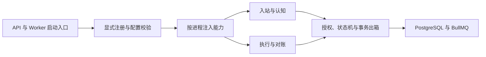

# Rica 插件架构重构计划

依据[系统设计规范第 17 章](多平台多身份%20AI%20虚拟角色认知与自主行为系统设计规范.md#sec-17)，并沿用第 09 章的平台契约、第 10 章的审批执行规则和第 13 章的事务出箱。本文补充实施顺序与验收，现有 M1–M4 的行为以[开发路线图](roadmap.md)为回归基线。

## 1. 重构起点

| 当前实现 | 需要收敛的边界 |
| --- | --- |
| `registerPlugins` 已校验重复 ID、契约版本和未知实现。`mock-a`、`mock-b` 和 `simulated` 已有稳定 ID 和版本。 | 在进程入口统一装配显式允许列表、配置校验、宿主依赖与就绪状态。 |
| Worker 已能接收模型实现，模拟入站已支持启用列表。草稿、审批复核和执行路径仍有直接解析内置适配器的调用。 | 由启动入口注入能力解析器，领域流程使用同一部署选择，审批与执行复核同一版本。 |
| 入站记录适配器 ID 和版本，草稿记录模型 ID 和版本，模拟提案已有适配器版本和审批摘要。 | 补齐审批与许可所需的执行适配器 ID、实现版本和能力契约版本，保留旧记录语义。 |
| 本机试点已有独立的只读事件接收、单次发送及结果恢复。 | 先把只读协议接入平台能力，随后单独装配写入与对账，保留已有账本和进程权限。 |
| 已有授权候选排序和长期评测。 | 排序保留原算法，评测保留原输入和指标。出现第二种实现时，再抽取对应扩展点。 |

代码基线见[注册表](../packages/runtime/plugin-registry.ts)、[模型提供方](../packages/runtime/model-provider.ts)、[模拟适配器](../packages/runtime/simulated-platforms.ts)、[审批](../packages/persistence/action-review.ts)和[模拟执行](../packages/persistence/simulation-execution.ts)。

## 2. 目标架构

采用随 Rica 一起发布的 TypeScript 实现。Hono API 和各 Worker 在各自入口使用工厂显式注册，部署配置按 ID 启用。进程装配按当前职责分配能力，替换通过部署重启完成。首轮沿用现有单包与 pnpm 锁文件。

| 能力 | 插件可见范围 | 宿主负责 |
| --- | --- | --- |
| `PlatformAdapter` 入站与读取 | 验签、协议解析、事件归一化、按账号读取 | 独立校验远端主体与绑定，复核角色、身份和账号，持久化游标、入站、去重和出箱。 |
| `PlatformAdapter` 执行与对账 | 使用限定账号、目标、已批准正文和原幂等键执行，返回类型化结果或回执 | 审批摘要、版本和时效复核，发送许可、配额、账本、重试条件及人工处置。 |
| `ModelProvider` | 区分内部决策与对外写作，接收当前用途允许的最小上下文、输出约束、时限和取消信号 | 授权检索、证据复核、结构化输出校验、预算预留和结算。 |
| `MemoryRanker` 与 `Evaluator` | 排序只见已授权候选，评测只见批准的回放投影 | RLS 和用途过滤、候选集合检查、条数与 token 上限，以及指标持久化。 |

注册项最少声明能力类型、稳定 ID、实现版本、宿主契约版本、配置校验和必需依赖。同一能力类型下 ID 唯一。必需项启动失败时，相关进程不报告就绪。可选项失败时，对应能力显示不可用。生命周期为校验、注册、启动、就绪、停止接纳、释放资源。启动失败按已成功启动的逆序清理，停止可重复调用。

插件只接收窄接口和当前调用需要的数据。通用数据库连接、管理凭据和跨身份记忆查询保留在宿主。配置只引用凭据。日志和进程内诊断只记录能力、ID、版本、就绪结果及脱敏错误码。可恢复业务事件继续通过事务出箱和 BullMQ。

本计划范围为随部署发布的受信实现。动态安装、管理端上传代码、生产热替换及第三方代码隔离另立工作包。常驻轮询须有独立授权并通过 PL-03。

## 3. 交付顺序

| 阶段 | 实施内容 | 退出条件 |
| --- | --- | --- |
| P0 固化基线 | 在独立 PostgreSQL 与 Redis 环境记录当前结果。盘点 API、入站、认知、审批、执行及回放的实际解析点，标出数据库硬编码的平台限制和旧记录缺失的版本字段。 | 三身份、双模拟平台从入站到回执跑通。记录现有提案状态、回执、审计与授权断言，形成切换前后可比对的结果。 |
| P1 建立装配入口 | 扩展现有注册表，补配置校验、依赖检查和可选生命周期。由进程入口提供允许列表。沿用默认模型和现有环境变量。 | PL-01。重复、未知、不兼容、配置无效、缺依赖的行为明确。可选能力故障有诊断，必需能力故障拦截进程就绪，部分启动失败后资源释放。 |
| P2 迁移模拟链路 | 先迁移模型与两个模拟适配器，再把入站、草稿、审批复核和执行的直接查找改成入口注入。同步盘点 HTTP 和数据库对模拟平台 ID 的限制。保留现有数据格式和实现版本。 | PL-02 模拟范围与原有 M1–M4 回归通过。原数据、命令、队列事件、审批与回执行为可复现。此阶段无需数据库迁移。 |
| P3 切换版本与许可 | 复用现有版本列，对照实际缺口增加字段及约束。回放记录实际使用的实现；新审批摘要绑定执行适配器 ID、实现版本和能力版本。预览、批准与领许可使用相同版本判定。 | PL-04。切换后旧版本的待审或已批准但未发送提案不能取得新许可；旧回执可读，在途请求仍按原账本对账，未知结果额外发送为 0。通过旧库升级与混合版本切换测试。 |
| P4 接入只读平台能力 | 把现有本机连接器的认证、协议解析和事件读取接入显式装配。复用独立读取凭据、游标、事件去重、租约、退避和单次／限时入口。 | PL-02 只读范围通过，写调用为 0。重启、空页、游标过期、重复页、限流和在途暂停保持既有语义。常驻模式作为单独验收，覆盖 PL-03。 |
| P5 接入受控执行与对账 | 使用同一平台契约的独立执行能力，保留单次执行入口、执行数据库角色、审批和现有回执账本。隔离夹具覆盖正常回执、丢响应、重放、限流、锁定和人工结案。 | 模拟与只读的真实写调用为 0。受控发送仅在批准、版本和绑定均有效时发生。丢响应时仅沿用原幂等键恢复，远端结果和已确认回执各只产生一次。 |

P0 至 P2 先交付可以独立验收的模拟主链。P3 是切换实际执行能力的前置条件。排序与评测接口按第二实现的需求另起工作包；宿主继续限制候选范围和指标写入。

## 4. 数据迁移、发布与回退

1. **同版本迁移。** P2 移动装配入口时保留 `mock-a`、`mock-b`、`simulated` 的现有 ID 和版本，保留归一化规则、幂等键及出箱事件类型。入口兼容期间保留旧调用包装，等生产入口和回归都已覆盖再移除。
2. **扩展旧库。** P3 先增加兼容字段和约束。用已有证据确认的版本可以回填。缺失版本信息的记录保留历史语义，执行资格按新版复核规则判定。旧审批摘要、历史回执和审计只读保留。
3. **协调切换。** 先暂停发放新的执行许可并排空可安全完成的尝试；隔离待核对项。升级 API、认知 Worker 和独立执行器后再切换新版摘要与许可判定。切换时验证旧执行入口无法给新审批格式发放许可。对于已入账或正在核对的尝试，保留原账号、目标、请求幂等键和账本。
4. **安全回退。** P1–P2 可回到上个镜像与配置。P3 之后，应用回退仍保留新增数据库字段。先维持发送暂停，再确认版本判定兼容。失效提案走重新生成与审批；未知结果优先按原账本和原凭据对账，无法确认则进入人工处置。

P3 迁移在数据库中立即拦截旧摘要的新审批及新许可。先停止旧审批入口、认知 Worker 与模拟执行器，再应用迁移并启动同版本进程。旧执行器在混跑时可能把新策略下的提案置为阻止状态，因此审批与执行进程应一起切换。已经持有许可的尝试保留原回执入口。回退应用时保留数据库校验，维持旧执行器批处理停用。既有账本通过兼容的回执与对账入口核对，恢复新许可须使用支持 P3 的版本。

## 5. 验收与执行清单

| 验收 | 必须观察到的结果 |
| --- | --- |
| PL-01 注册与依赖 | 非法注册不可用，日志标明进程、能力、插件版本和脱敏错误码。部分启动失败及重复停止均释放资源。 |
| PL-02 权限 | 错配账号、身份、平台、会话或联系人被拒绝。模拟与只读能力的真实写调用数均为 0。输入、日志、回放和队列中没有越权内容或凭据。 |
| PL-03 清理与恢复 | 若引入常驻轮询，隔离环境中验证多实例争抢、启停与重启。停用后请求数为 0，同一配置最多一个有效轮询实例，游标与去重可恢复。 |
| PL-04 执行切换 | 更换执行实现、版本或契约后，旧审批拿不到新许可。在途结果仍可对账，未知结果因切换产生的额外发送数为 0。 |
| M1–M4 回归 | 保留多身份多平台流程、权限与审批、账本恢复、调度、反思及评测的既有验收。修改排序路径时单独复跑原规模基准，授权检索 P95 门槛为 300 ms。 |

开发先跑[注册表测试](../packages/runtime/plugin-registry.test.ts)和受影响的集成用例。阶段交付前按改动范围运行 `pnpm run typecheck`、`pnpm test`、`pnpm run build` 及 `pnpm run test:integration`。数据阶段另做全新安装、旧库升级、Prisma 一致性及旧执行进程切换验证。真实写入相关用例统一使用隔离协议夹具。

实施时按 P0–P5 分组提交。每阶段通过后更新[路线图](roadmap.md)，记录默认配置、通过的验收、剩余限制和回退条件。
